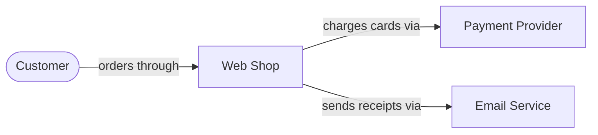
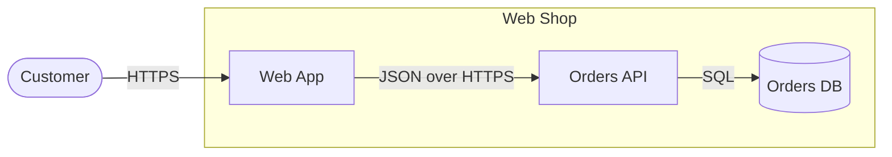
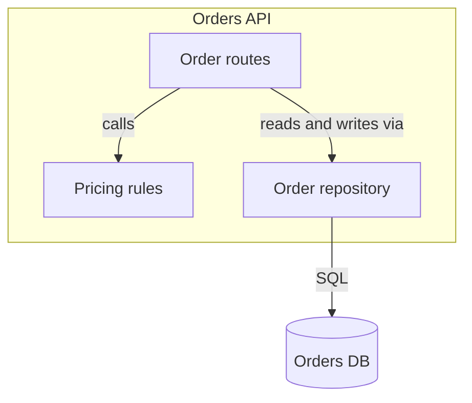
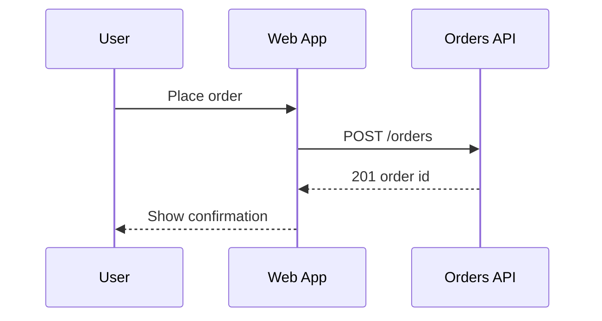

# Abstraction levels and starter templates

Read only the level you chose in step 1. The levels follow the context, container, component and code ladder of the C4 model (c4model.com), drawn here with plain Mermaid because native Mermaid C4 blocks are still marked experimental and are not checked by the script. The code level is not drawn: read the code.

## Contents

- Context
- Container
- Component
- Interaction (sequence)
- Deployment
- Choosing between levels

## Context

Shows: the system as a single box, the kinds of people who use it, and the external systems it talks to.
Leave out: anything inside the system, any technology names for the system's own parts.
Test: a non-engineer can say what the system is for after one look.

## Container

Shows: the runnable or deployable parts (web app, API, worker, database, queue) inside one system boundary, with the protocol on every edge.
Leave out: classes, modules, libraries, cloud account structure.
Test: every box is something you could point at in the deployment and restart on its own.
Source hints: compose or orchestration files, process lists, Dockerfiles, connection settings.

## Component

Shows: the major parts inside one container and how they depend on each other. One diagram per container.
Leave out: other containers (show each as a single external node if a component calls it), every helper class.
Test: the group names match directory or package names a developer will search for.
Grouping: one subgraph per layer (handlers, domain, persistence) or per feature area, not both.

## Interaction (sequence)

Shows: one scenario in time order: who sends what to whom.
Cast: the actors and containers involved, at most 7. Declare every participant first, with an alias, in the order they first speak.
Messages: the call as written ("POST /orders", "Charge card"); solid arrow `->>` for a call, dashed `-->>` for a reply. Use `alt`/`else` for one meaningful branch, `loop` for a retry that matters, never more than 2 levels of blocks.
One scenario per diagram; name it in a `%%` comment.

## Deployment

Shows: where containers run: regions, clusters, networks, managed services.
Leave out: request flows (draw those as container or interaction views).
Use nested subgraphs for region then network, depth 2 at most. Name boundaries after the real thing (the cluster name in the infrastructure code), and show only edges that cross a boundary.

## Choosing between levels

| The user says | Draw |
|---|---|
| "how does it all fit together" | context, then container |
| "what services do we have" | container |
| "how is the orders service built" | component of that container |
| "what happens when a user logs in" | interaction |
| "where does this run" | deployment |
| "show everything" | refuse the single diagram; give a context view plus a list of the diagrams that would follow |
