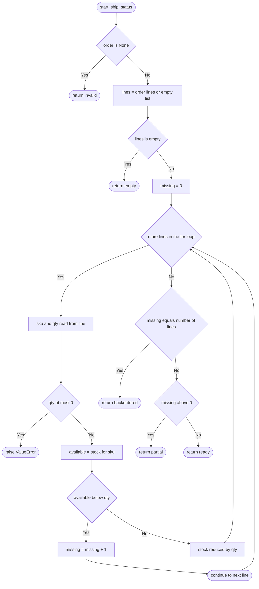

# control-flow-mermaid-from-code

## One line

Draws one function's control flow as a Mermaid flowchart and checks the diagram against a line-by-line coverage table and a branch count.

## What it does

The skill takes the source of a single function and produces a top-down Mermaid flowchart. Every `if`, `elif`, loop header and exception handler becomes a diamond with Yes and No edges. Every `return`, `raise`, `throw`, `continue` or `break` that is not the function's last statement becomes an early-exit terminal. Consecutive plain statements share one rectangle, so the diagram stays readable at the 80-line limit.

After drawing, the skill builds a coverage table that maps each numbered source line to its node id, its kind and whether it is a branch. It then counts the branch points it found in the source and the branch shapes it drew in the diagram. The two counts must match. A mismatch is a defect in the diagram, not something to explain away.

The output has five fixed sections: status, diagram, coverage table, branch count and open questions. Missing input, a repository, several files or a function over 80 lines stop the run with a status and a question list instead of a guessed diagram.

## When to use

Use it when a reviewer wants to see the paths through one function, when a developer asks for a flowchart from code, or when a diagram must be checked against the source before it goes into documentation. It suits short business-rule functions with guard clauses, validation functions and small loops that return a status.

## When not to use

Do not use it for a whole repository, a folder, several files, or a function over 80 lines. Do not use it for call graphs across functions, architecture diagrams, sequence diagrams or traces of what actually ran. It does not read the function's callers and does not know which inputs occur in production.

## Requirements

Nothing beyond a text-capable agent. The function source and its language must be supplied in the conversation. No network, no scripts and no packages are needed.

## Example

Input: the 25-line sample in `fixtures/ship_status.txt`, a Python function with an `if` guard, a `for` loop, a `raise`, a `continue` and three final returns.

### Status

complete

### Diagram

### Coverage

| Line | Node | Kind | Branch |
|---|---|---|---|
| 1 | N1 | start | no |
| 3 | N2 | decision | yes |
| 4 | N3 | exit | yes |
| 5 | N4 | process | no |
| 6 | N5 | decision | yes |
| 7 | N6 | exit | yes |
| 8 | N7 | process | no |
| 10 | N8 | decision | yes |
| 11 | N9 | process | no |
| 12 | N9 | process | no |
| 13 | N10 | decision | yes |
| 14 | N11 | exit | yes |
| 15 | N12 | process | no |
| 16 | N13 | decision | yes |
| 17 | N14 | process | no |
| 18 | N15 | exit | yes |
| 19 | N16 | process | no |
| 21 | N17 | decision | yes |
| 22 | N18 | exit | yes |
| 23 | N19 | decision | yes |
| 24 | N20 | exit | yes |
| 25 | N21 | end | no |

### Branch count

Found: 13
Drawn: 13
Match: yes

### Open questions

None.

## Limits

The skill draws what the source says. It does not check that the logic is correct, that the conditions can occur, or that the code runs. It reads only the function it is given, so calls to other functions are shown as plain process nodes with no detail. It counts a `continue` or `break` as an early exit, which some readers may not expect. The diagram is not rendered or checked against a Mermaid parser in this package, so a renderer may still reject an unusual label. Lines are numbered as supplied, so a source with a changed header line shifts every row.

## Status

Provisional. Lint-clean, one smoke run. Not independently verified.
