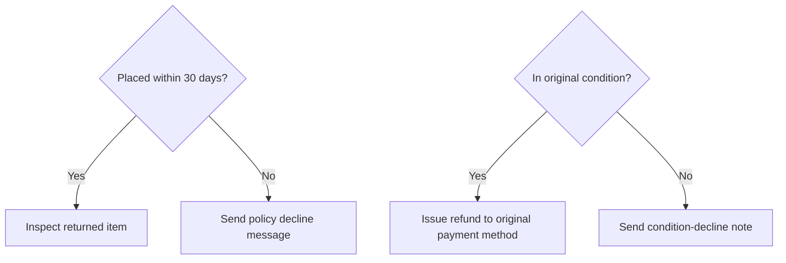

# procedure-to-flowchart

## One line

Turns a written refund-style procedure into one Mermaid flowchart with every decision exit labelled, every path ended, and gaps listed instead of filled in.

## What it does

The skill reads a numbered or prose procedure and gives each step an ID in source order. It classifies each step as an action, a decision or an end point. Decisions are drawn as diamonds with the exits the text states, typically Yes and No, and each exit is labelled with those words. Branch actions written inside a step, such as "if no, send the note", receive their own node so the path is visible.

Before output, the skill traces every path to confirm that it reaches an end node or an explicit unresolved marker. If the text names only one exit of a decision, the second exit is not invented. It is drawn as an "Outcome not stated" node and listed under Unresolved with the step it belongs to.

The output is three parts: a Mermaid code block, a node table with type, source step and outgoing edges, and a self-check table. Procedures that would need more than 25 nodes are split at a decision boundary into labelled parts, with a connector end node in each.

## When to use

Use it when a runbook, support macro, refund policy or checklist has conditional lines such as "if the order is older than 30 days, decline" and you need a diagram that a reviewer can check against the source text. It suits review of an internal process before it is handed to a team, or a first draft of a flow that will later be drawn in a more polished tool. Because the output is plain Mermaid, it can be pasted into any Markdown viewer that renders Mermaid.

## When not to use

Do not use it to redraw a diagram from a photo or scan, to design a service architecture, or to produce a sequence diagram between systems. It does not create Excalidraw files; people looking for that format will get Mermaid text instead. It will not guess what happens in a branch the source leaves out, so a procedure written loosely will come back with several unresolved entries rather than a finished chart.

## Requirements

A text-capable agent. No scripts, no network access, no installed packages. The procedure must be supplied as text in the conversation.

## Example

Input (nine steps, two decisions, abbreviated here to the decisions):

```
4. Was the order placed within 30 days? If no, go to step 5. If yes, go to step 6.
7. Is the item in original condition? If yes, go to step 8. If no, send the condition-decline note and go to step 9.
```

Output excerpt from the smoke run:



The full output, with the nine-row node table and the self-check, is in VERIFICATION.md.

## Limits

The skill follows the procedure text only. It cannot check whether the policy is correct, whether the steps are in the right order in the real world, or whether a branch that looks unstated is covered by another document. Thresholds such as the four-part maximum and the eight-decision limit per part are working values and are labelled as such in the file. Long procedures with many nested conditions will produce more unresolved entries than a reader may want, and the skill does not merge them.

## Status

Provisional. Lint-clean, one smoke run. Not independently verified.
