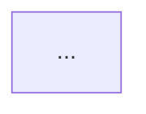

# Procedure to Flowchart

Turns one written procedure into one Mermaid flowchart. Each decision is drawn with the exits the text states, each path reaches an end, and any missing exit is marked as unresolved instead of being guessed.

## Inputs

- The procedure as plain text, numbered or in prose. If it is an image or scan, stop (see Refuse / stop when).
- Optional diagram title, 8 words maximum. Default: the first step's verb phrase.

## Workflow

1. **Extract steps.** One numbered item, or one sentence holding one action, is one step. Number the steps S1, S2 ... in source order, using the source number when the text is numbered. Output: a list of step IDs, each with its source wording (25 words maximum).
2. **Classify each step.** Output: a Type for every step.
   - ACTION: does one thing and leads to one next node.
   - DECISION: asks a question or tests a condition with two or more outcomes. Trigger words: "if", "whether", "when", "otherwise", "else", "?".
   - END: closes or finishes the flow ("close", "stop", "end", "done", or a final output).
   - A branch action written inside a step ("If no, send the note") becomes its own node, ID S<n>a, typed ACTION.
3. **Wire the edges.** Output: an edge list in the form `from -> to | label`.
   - DECISION: one edge per stated outcome. Label is "Yes" or "No", or the stated outcome in 4 words or fewer.
   - ACTION: one edge to the next step in source order, unless the text says "go to step k" or ends the flow.
   - "Go to step k" is an edge to S<k>. Do not add an edge the text does not give.
4. **Mark missing exits.** If a DECISION or ACTION names one exit and not the other (for example "if yes, continue" with no "if no"), do not invent the second one. Add a node U<n> labelled "Outcome not stated" and list it under Unresolved.
5. **Check that every path ends.** Follow each path forward. Each path must reach an END node or a U<n> node. A loop is allowed only when the text states the exit condition; otherwise add U<n> at the loop.
6. **Apply naming and label rules.**
   - Node IDs: S1, S7a, U1. No dots, spaces or hyphens in IDs.
   - Labels sit in double quotes. Replace any double quote inside a label with a single quote.
   - ACTION label starts with an imperative verb ("Send policy decline message").
   - DECISION label is a question ending in "?", drawn as a diamond: `S4{"Placed within 30 days?"}`.
   - END label is drawn as a stadium: `S9(["Close the ticket"])`.
   - Edge labels use the form `-->|Yes|`, `-->|No|`, or the stated outcome.
7. **Split when large.** Count every node, including U and END nodes. If the count is above 25, split at the first DECISION whose two exits both lead to later steps. Part 1 ends in an END node labelled "Continue at S<k>", and Part 2 starts at S<k>. Each part gets its own Mermaid block and node table.
8. **Build the node table and the Unresolved list** using the output contract below.
9. **Run the self-check.** Do not return a diagram that fails any row.

## Threshold table

| Check | Value | If exceeded or failed |
|---|---|---|
| Nodes per diagram | 25 (spec cap) | Split under step 7 |
| ACTION or END label | 8 words maximum | Shorten; keep the object and the verb |
| DECISION label | 10 words maximum, ends in "?" | Rewrite as a question |
| Edge label | 4 words maximum | Use the source wording |
| Exits per yes/no DECISION | 2, each taken from the text | Missing exit becomes U<n> |
| Parts per procedure | 4 maximum (working value) | Stop and ask which part to draw |
| Decisions per part | 8 maximum (working value) | Split at the next DECISION |
| Loop | needs a stated exit condition | Otherwise U<n> at the loop |

The 25-node cap comes from the requesting spec. The other limits are working values chosen for this skill, not published standards.

## Output contract

Use these headings, in this order, for each part. If there is one part, drop "Part n of m" from the heading.

```
## Flowchart [Part 1 of 2]


## Node table [Part 1 of 2]
| ID | Type | Label | Source | Outgoing |
|---|---|---|---|---|

## Unresolved
- U1: <step ID> - <what the text does not state>
(or the single line: None.)

## Self-check
| Check | Result |
|---|---|
| Nodes used | N of 25 |
| Every DECISION has its stated exits labelled | pass or fail |
| Every path reaches END or U | pass or fail |
| Labels within word limits | pass or fail |
| No branch invented | pass or fail |
```

Node table rules: Source is the step number as written ("step 4"). Outgoing lists `ID (label)` pairs separated by commas. An END node shows "none".

## Refuse / stop when

- The text has no sequence of at least two actions and no decision. Reply `Not a procedure: <reason>` and nothing else.
- The input is an image, a scanned PDF, or a diagram to be redrawn. Ask for the text.
- The user asks you to fill in outcomes, default answers or branches that the text does not state. Use U<n> instead and say so.
- The procedure needs more than 4 parts. Stop and ask the user to name the section to draw.
- The request is for an Excalidraw file, an architecture diagram between services, or a sequence diagram. This skill produces Mermaid flowcharts from text only.

## Files in this package

- `SKILL.md` (this file): the procedure and output contract. No scripts are included.
- `LICENSE.txt`: Apache License 2.0.
