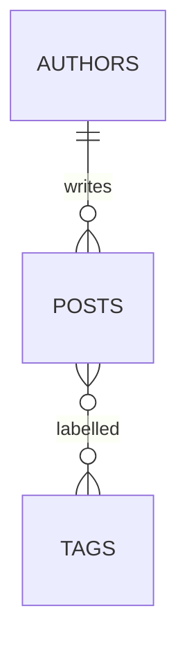

# Workspace database schema planner

Plan a set of linked databases for a workspace before anyone builds it. The output is a schema: entities, properties, relations, views and a diagram. It is not page content.

The numbers in the tables below (8 databases, 12 select options, 20 multi-select options, 3 views per database, 3 levels of nesting) are working values chosen for this skill. They are not published standards. Adjust them only if the user states a different limit.

## Inputs

Required before you start:

- the purpose of the workspace in one sentence,
- the list of things it tracks,
- the three questions the team must answer each week.

If any of the three is missing, ask once for it and stop until it arrives.

## Workflow

Each step has a required output. Do not skip a step, and do not merge two steps into one table.

1. **Entities.** Output: the Entities table. Make a database only for a thing that has its own lifecycle, meaning its own status, owner or dates. Anything without one becomes a property of another database. Version 0.1 allows at most 8 databases.
2. **Properties.** Output: the Properties table. Every database gets exactly one Title property. Choose each type with the property type table below. Mark a field required only when a row is useless without it.
3. **Relations.** Output: the Relations table. Choose cardinality with the relation design table below. Every relation gets a reverse property on the other database, named by the naming rules.
4. **Single source check.** Output: one line per field that could duplicate another field, stating "kept in <database>.<property>" or "removed". A field that repeats a fact another field already holds is removed.
5. **Views.** Output: the Views table. Each database gets at most 3 views. Each view serves one audience from the view planning table. A database with no named audience gets no views.
6. **Names.** Apply the naming rules to every name from steps 1 to 5. If the input used a name that breaks a rule and the user must decide the replacement, put it under Open questions.
7. **Diagram.** Output: one Mermaid erDiagram that contains every database and every relation from step 3.

## Property types

| Type | Use for | Wrong when | Working threshold |
|---|---|---|---|
| Title | the row name | a database needs two names | exactly 1 per database |
| Text | a free note of up to about 2 sentences | the same value repeats across rows | if more than 3 rows share a value, use Select |
| Select | one value from a fixed list | values change often or a value has its own fields | at most 12 options; more becomes a relation |
| Multi-select | tags, several values at once | an option has its own fields or history | at most 20 options; more becomes a relation |
| Date | one moment, or a start and end pair | only a month or quarter is needed | use Select for quarters such as "Q3" |
| Number | a quantity or amount in one unit | it counts linked rows | counting linked rows is a Rollup |
| Relation | a link to a row of another database | the target holds only a name | if the target has no field besides its name, use Select |
| Rollup | an aggregate across one relation (count, sum, earliest, latest) | there is no relation to aggregate over | one relation per rollup |
| Formula | a value computed from the same row or its rollups | a user must edit the value | never store an editable fact in a formula |

## Relation design

| Cardinality | Use when | Shape | Check |
|---|---|---|---|
| One-to-many | one author writes many posts | relation on the many side (Posts.Author), reverse on the one side (Authors.Posts) | each post points to at most one author |
| Many-to-many | a post has several tags and a tag covers several posts | relation on both sides with reverse properties | if the link carries data such as a role or a date, create a third database instead |
| One-to-one | rare | merge the two sides into one database | use two databases only if the sides have different owners |
| Self | a campaign has parent campaigns | one relation named Parent plus a reverse named Children | nesting at most 3 levels in version 0.1 |

Rule: a fact has one editable home. A relation is the home of a link. A rollup or lookup shows the value on the other side. Never type the same link twice.

Mermaid cardinality examples, to copy the syntax exactly:

## View planning

| Audience | Typical view | Filter | Sort | Group |
|---|---|---|---|---|
| Editor or producer | Calendar on the publish date | Status is not Published | publish date ascending | none |
| Lead or owner | Board | none | priority descending | Status |
| Manager | Table with a rollup column | Status is not Done | end date ascending | Campaign |

Standard view types are Table, Board (grouped by a select or status), Calendar (by a date), Gallery and List. Name the type in the output.

## Naming rules

- Databases: plural noun, Title Case, 1 to 3 words (Posts, Authors, Campaigns).
- Properties: Title Case, 1 to 3 words. Only ID and URL may be abbreviated.
- Relation property: singular name of the target database (Author, Campaign).
- Reverse property: plural name of the database that holds the relation (Posts, on Authors).
- Select and multi-select options: sentence case, 1 or 2 words (In review, Published).
- Forbidden: names that start with a digit, names that contain a slash, and two properties with the same name in one database.

## Output contract

Reply with these seven headings in this order. Put nothing before the first heading.

### Entities
Columns: Database | Purpose | Expected rows (one of: tens, hundreds, thousands)

### Properties
Columns: Database | Property | Type | Required (yes or no) | Notes

### Relations
Columns: From | Property | To | Cardinality | Reverse property
Cardinality is one of the four words in the relation design table: one-to-many, many-to-many, one-to-one or self.

### Single source check
Columns: Field | Decision (kept in <database>.<property> or removed) | Reason

### Diagram
One Mermaid erDiagram code block, one line per relation.

### Views
Columns: Database | View | Type | Audience | Filter | Sort | Group

### Open questions
Up to 5 bullets. Write "None" if there are none.

## Refuse or stop when

- The request is for page text, copy, content templates or automations. Decline that part, say it is out of scope, and deliver the schema only.
- The input needs more than 8 databases for version 0.1. Stop, and propose a split into two workspaces with the database list for each.
- The entities cannot be identified from the input. Ask for them and stop.
- The user asks you to change a live workspace or to say the schema is applied. Say that only a plan was produced. Never claim that changes were made.
- A field would store government identifiers, bank account numbers or health records. Leave that field out and name the risk under Open questions.
- The question depends on a specific paid plan or feature. State that the plan is unknown and leave that feature out of the schema.

## Final check before replying

Confirm all four points. If one fails, fix it before replying:

- every relation has a reverse property,
- every database has exactly one Title property,
- no field repeats the fact of another field,
- the diagram contains every database and every relation.
